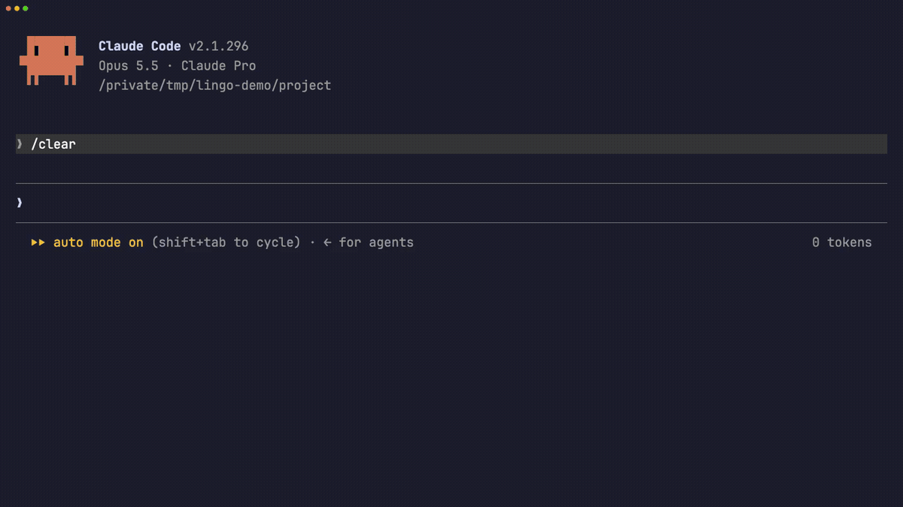

# lingo-switch

**Switch the language Claude Code chats in with one keystroke.** Type `/lang`, press a digit, and Claude's next reply comes back in Cantonese, Classical Chinese, Simplified Technical English, or pirate.



lingo-switch is a Claude Code mod: a plugin of TypeScript function hooks. It has no dependencies and no build step, and it is about 200 lines.

## Install

lingo-switch needs a Claude Code build that loads function-hook mods. It is tested on 2.1.292 and 2.1.296. The mod API is early access, so a later release can break it.

In a Claude Code terminal session, run:

```
/plugin install lingo-switch --marketplace patrick-yip/claude-lingo-switch
```

Answer `y` to add the marketplace, then press Enter to pick the user scope. The mod is active at once, with no restart. To remove it, open `/plugin` and uninstall `lingo-switch`.

## Use

| You type | What happens |
| --- | --- |
| `/lang` | A one-row bar opens above the prompt with every profile |
| `1` to `9` (empty prompt) | Switches to that profile. The bar stays up. |
| `0` or **Dismiss** | Hides the bar |
| `/lang pirate` | Switches directly, no bar |

The active profile shows in an accent box. Your pick and the bar stay put across `/clear` and new sessions.

## Profiles

| Key | Id | Claude replies in |
| --- | --- | --- |
| 1 | `en` | Plain English. The default. |
| 2 | `yue` | Spoken Hong Kong Cantonese (口語), technical terms kept in English |
| 3 | `zh-hant` | Formal written Traditional Chinese (書面語) |
| 4 | `ste100` | [ASD-STE100](https://www.asd-ste100.org/) Simplified Technical English: short sentences, active voice, one instruction per sentence |
| 5 | `caveman` | Caveman English. `git rebase` stays `git rebase`. |
| 6 | `wenyan` | Classical Chinese (文言文), e.g. 此 PR 有 bug 三，宜速修之。 |
| 7 | `pirate` | Pirate slang, aye |
| 8 | `shakespeare` | Early Modern English, thou and thee |
| 9 | `yoda` | Inverted, the word order is |

**Profiles change chat only.** Every profile keeps specs, emails, files Claude writes, code, code comments and commit messages in plain English. Pirate mode never ships a pirate commit message. Every profile also tells Claude that accuracy beats voice: facts, numbers and commands never bend to fit the style.

## How it works

The mod hooks three engine events:

1. **`prompt.submit`** attaches a short hidden note to each message you send: the active profile and its rules. A note next to your latest message wins over older instructions, so a switch takes effect on the very next reply.
2. **`command.run`** answers `/lang`.
3. **`ui.render`** draws the bar above the prompt.

**It never touches the system prompt.** A change there can invalidate the prompt cache for the whole conversation on each switch. The note rides at the end instead, after the cached history. It costs about 75 to 140 tokens per message, an estimate from its length. A typical Claude Code request is far larger.

The note names its source and its scope. It reads: "The user picked this profile with /lang. For reply language only, it takes precedence over AGENTS.md, CLAUDE.md and the `language` setting." It does not claim to override anything else. The store keeps only a profile id, and the mod checks that id against the built-in list. A changed store file can only select one of the nine profiles; it cannot inject text.

## Add a profile

Profiles are plain data in [`hooks/profiles.ts`](hooks/profiles.ts). Add an object:

```ts
{
  id: 'haiku',
  label: 'Haiku',
  rules: 'Reply in haiku: three lines of 5, 7 and 5 syllables. Keep technical terms exact.',
}
```

Keep `rules` about language and voice only. Digits `1` to `9` go to the first nine profiles; later ones work through `/lang <id>` and a click.

## Known limits

1. **The `language` setting still adds its own instruction.** If your `settings.json` has `"language": "..."`, Claude Code adds that instruction outside the hooks a mod can reach. The per-message note won over it in our tests, but remove the setting for a clean prompt.
2. **The bar does not take keyboard focus.** Digit keys work while the prompt is empty. To reach a profile past 9, click it or press `ctrl+x tab`.
3. **The bar draws on terminal and desktop only.** The mobile app has no band above the prompt, so use `/lang <id>` there.

## Develop

Run the mod from a local clone:

```
claude --plugin-dir ./claude-lingo-switch
```

Check it:

```
claude plugin validate ./claude-lingo-switch
claude plugin test ./claude-lingo-switch
```

The tests cover the default profile, `/lang <id>`, the bar's press and dismiss on terminal and desktop, and the per-message note.

The demo GIF comes from [`assets/demo.tape`](assets/demo.tape). Re-record it with [VHS](https://github.com/charmbracelet/vhs); the tape's header lists the setup.

## License

[MIT](LICENSE)
